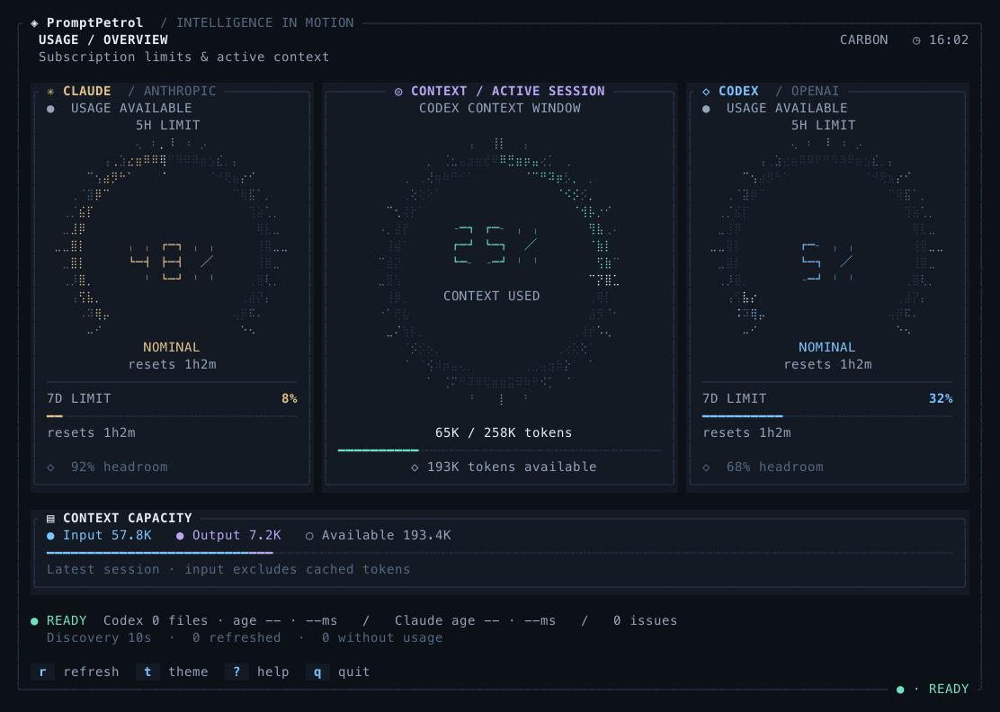

# PromptPetrol

### The instrument cluster for your AI coding cockpit

PromptPetrol is a fast, local-first Rust terminal dashboard for seeing Claude and Codex usage at a glance. It turns opaque subscription limits and context-window pressure into a readable cockpit: illuminated gauges, headroom meters, context rings, diagnostics, and a little bit of theatre.

<p align="center">
  
</p>

<p align="center"><em>Carbon theme at 120×40, rendered by PromptPetrol with illustrative sample data.</em></p>

<p align="center">
  <a href="https://github.com/shauntasin/PromptPetrol/actions"></a>
  <a href="https://crates.io/crates/promptpetrol"></a>
  <a href="https://crates.io/crates/promptpetrol"></a>
</p>

> **Know your runway before the next prompt takes off.**

PromptPetrol is designed for developers who live in the terminal and use AI coding tools all day. It is deliberately local-first: Codex usage comes from local session logs, Claude utilization comes from the official usage endpoint, and the dashboard does not pretend to be a billing ledger.

## Why PromptPetrol?

AI limits are easy to ignore until the moment they matter. PromptPetrol gives you a persistent visual readout while you work:

```text
 ┌────────────────────────────────────────────────────────────────────────────┐
 │ PROMPTPETROL                         CLAUDE        CODEX       CONTEXT      │
 │                                                                            │
 │       ╭───────╮              ╭───────╮             ╭───────╮               │
 │      ╱  42%    ╲            ╱  68%    ╲           ╱  31%    ╲              │
 │     │  5-HOUR   │          │  WEEKLY   │         │  WINDOW   │              │
 │      ╲         ╱            ╲         ╱           ╲         ╱               │
 │       ╰───────╯              ╰───────╯             ╰───────╯               │
 │   RESET 01:42:18          HEADROOM 32%          INPUT ▰▰▰  OUTPUT ▰▰       │
 │                                                                            │
 │   ● LIVE   CODEX SESSIONS: FRESH   CLAUDE: FRESH   REFRESH: 10s             │
 └────────────────────────────────────────────────────────────────────────────┘
```

The result is glanceable enough for a second monitor, informative enough for debugging stale data, and lightweight enough to leave running all day.

## Features

### A cockpit built for real terminal work

- Illuminated arc gauges for Claude five-hour and weekly utilization.
- Local Codex five-hour and weekly rate limits from session logs.
- Active Codex context-window usage with input, output, and available-capacity views.
- Responsive layouts from full 120×40 dashboards to compact 120×20 and odometer-style views.
- Ten palettes, including Carbon, Dracula, Nord, Gruvbox, Tokyo Night, Paper, Arctic, Solarized Light, and Transparent terminal-background mode.
- Animated dial lights and activity accents at 10 Hz without forcing data refreshes.

### Fast, careful ingestion

- Immediate first paint while data collection continues in the background.
- Incremental in-memory caching for unchanged Codex files.
- Append-aware JSONL parsing that waits safely for partial trailing records.
- Replacement and truncation detection with safe rebuilds.
- Symlink-safe session discovery with idle backoff from 10 to 120 seconds.
- Source freshness, attempt duration, and degraded-state diagnostics in the footer.

### Honest boundaries

PromptPetrol shows subscription utilization and context usage. It does not calculate API spend, import billing records, or persist a historical usage database. That keeps the display focused, understandable, and local-first.

## Install

### From crates.io

```bash
cargo install promptpetrol
promptpetrol
```

### From source

```bash
git clone https://github.com/shauntasin/PromptPetrol.git
cd PromptPetrol
cargo run --release
```

PromptPetrol needs a color-capable terminal with Unicode support. True color is recommended. No Nerd Font or image protocol is required. Use at least 120×32 for the full graphical layout.

## Run and control

```bash
promptpetrol
promptpetrol --refresh-interval-seconds 5
promptpetrol --config-file ~/dotfiles/promptpetrol.json
```

| Key | Action |
| --- | --- |
| `q` | Quit |
| `r` | Reload configuration and refresh data |
| `?` | Toggle keyboard help |
| `t` | Cycle theme for the current run |

The render loop is separate from data refresh. The UI can stay lively at 10 Hz while network and filesystem refreshes remain on the configured cadence (10 seconds by default).

## Configuration

The default configuration is `~/.config/promptpetrol/config.json`. PromptPetrol creates missing directories, writes the file with private permissions on Unix, and preserves the last valid configuration if a reload fails.

```json
{
  "theme": "carbon",
  "codex_import": {
    "enabled": true
  },
  "claude_import": {
    "enabled": true
  }
}
```

Available themes: `carbon`, `murphy`, `dracula`, `nord`, `gruvbox`, `tokyo-night`, `paper`, `arctic`, `solarized-light`, and `transparent`.

### Claude

PromptPetrol resolves the Claude OAuth token from:

1. `claude_oauth_token` in the selected config file.
2. The macOS Keychain item named `Claude Code-credentials`.

The token is sent as a Bearer credential only to `https://api.anthropic.com/api/oauth/usage`. On non-macOS systems, configure the token explicitly.

### Codex

PromptPetrol recursively reads `.jsonl` files from `~/.codex/sessions`, or from `codex_import.sessions_dir` when configured. It uses the latest `token_count` events for rate limits and context-window data, reparsing only files whose length or modification time changed.

## Release-minded Rust project

PromptPetrol is built with Rust 1.88+ and uses Ratatui, Crossterm, Serde, Reqwest, Chrono, and Color-Eyre. The project includes unit tests for imports, configuration, layouts, data freshness, and theme rendering.

```bash
cargo fmt --check
cargo clippy --all-targets --locked -- -D warnings
cargo test --all-targets --locked
cargo package --locked
```

Visual previews can be regenerated from the actual renderer without accessing provider APIs:

```bash
PROMPTPETROL_PREVIEW_DIR=/tmp/promptpetrol-previews \
  cargo test export_dashboard_previews -- --ignored --nocapture
```

## Troubleshooting

- **No Codex gauges:** verify the sessions directory contains readable `.jsonl` files with `token_count` events.
- **Stale Codex gauges:** press `r`; discovery may be in its idle backoff window.
- **No Claude gauges:** configure `claude_oauth_token` or confirm the macOS Keychain credential.
- **`CONFIG FAULT`:** validate the selected JSON file, then press `r`.
- **`DEGRADED`:** read the source diagnostics in the footer and fix the reported path, credential, or network issue.
- **Broken layout:** enlarge the terminal. Very small terminals show an enlargement prompt.

## Roadmap and contributing

Planning documents live in [`docs/ROADMAP.md`](docs/ROADMAP.md), [`docs/SCALING_PLAN.md`](docs/SCALING_PLAN.md), and [`TODO.md`](TODO.md). Contributions are welcome: keep changes local-first, preserve the separation between rendering and refresh, add tests for parser or layout behavior, and run the locked CI commands before opening a pull request.

## License

The repository does not currently declare a license. Choose and add a license
file before publishing the crate publicly; Cargo will then accept the matching
`license` or `license-file` metadata in `Cargo.toml`.
